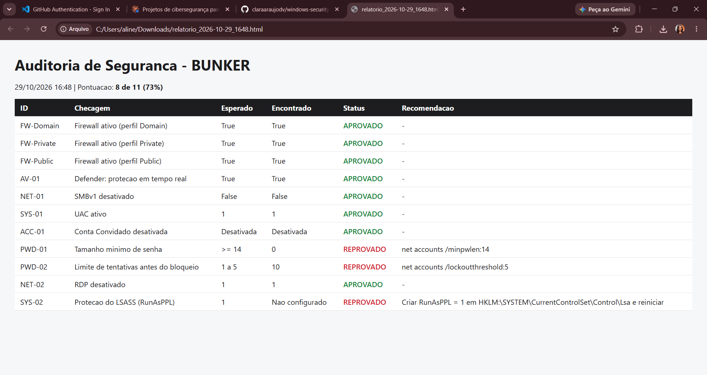

# Windows Security Auditor

PowerShell script that audits Windows security settings against a CIS-inspired baseline and generates HTML/JSON reports with remediation steps.



## The problem

Windows ships with several insecure defaults. On a fresh install, the minimum password length is **0**, accounts only lock after **10** failed logins, and LSASS memory protection is **off**. Checking these settings by hand means digging through the registry, local security policy and several PowerShell cmdlets.

## The solution

A single script that:

1. Reads each setting from its real source (cmdlets, registry, local security policy)
2. Compares it to a secure baseline
3. Marks it as **APROVADO** (pass), **REPROVADO** (fail) or **ERRO** (could not check)
4. Suggests the exact command to fix each failure
5. Exports an HTML report (color-coded, with a score) and a JSON file for other tools to consume

The script is **read-only**: it never changes any setting on the machine.

## Checks

| ID | Check | Secure value | Source |
|---|---|---|---|
| FW-Domain / Private / Public | Firewall enabled on every profile | `True` | `Get-NetFirewallProfile` |
| AV-01 | Defender real-time protection | `True` | `Get-MpComputerStatus` |
| NET-01 | SMBv1 disabled (exploited by WannaCry) | `False` | `Get-SmbServerConfiguration` |
| NET-02 | Remote Desktop (RDP) disabled | `1` | Registry |
| SYS-01 | UAC enabled | `1` | Registry |
| SYS-02 | LSASS protection (RunAsPPL) | `1` | Registry |
| ACC-01 | Guest account disabled | Disabled | `Get-LocalUser` |
| PWD-01 | Minimum password length | `>= 14` | `secedit` |
| PWD-02 | Account lockout threshold | `1 to 5` | `secedit` |

## How to run

Open **PowerShell as Administrator**, go to the project folder and run:

```powershell
Set-ExecutionPolicy -Scope Process Bypass
.\auditor.ps1
```

The reports are saved in the same folder as `relatorio_<date>.html` and `relatorio_<date>.json`.

**Requirements:** Windows 10/11, Windows PowerShell 5.1, administrator rights.

## Results on my own machine

On my personal computer the script scored **8 of 11 (73%)**. The 3 failures were all Windows defaults:

- Minimum password length was `0`
- Lockout threshold was `10` attempts
- LSASS protection was not configured

## What I learned

- **Don't rely on account names.** The Guest account is called "Convidado" on Portuguese Windows, so the script finds it by its well-known SID ending in `-501`, which never changes.
- **Pick language-independent sources.** `net accounts` prints localized text that is hard to parse. Exporting the policy with `secedit` gives stable `Key = Value` lines in any language.
- **Some data needs admin rights.** Without elevation, `secedit` fails silently and the password checks come back empty. The `#Requires -RunAsAdministrator` line prevents this.
- **Non-terminating errors skip `catch`.** `Get-ItemPropertyValue` only writes a warning when a registry value is missing. Adding `-ErrorAction Stop` turns it into a real error, so the `catch` block can report it.
- **A missing key can be a finding.** `RunAsPPL` does not exist by default, and its absence means the protection is off. So that case is reported as a failure, not as an error.

## Roadmap

- [ ] Map each check to its control number in the official CIS Benchmark for Windows 11
- [ ] `-Fix` mode to apply the recommended settings (with confirmation)
- [ ] More checks: BitLocker, automatic updates, PowerShell logging, audit policies
- [ ] Web dashboard consuming the JSON output

## Author

**Clara Araújo** — Software Engineering student at ICEV, studying for CompTIA Security+

GitHub: [github.com/claraaraujodv](https://github.com/claraaraujodv)  
LinkedIn: [linkedin.com/in/clara-araújo-a65a73347](https://www.linkedin.com/in/clara-ara%C3%BAjo-a65a73347/)
